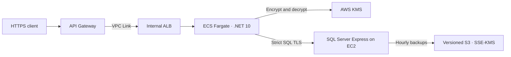

# Cloud Resilience Laboratory

How do you ship a change to a private application, verify it with its real dependencies, and recover service when its network or database fails? I designed and implemented this AWS lab to exercise those three problems end to end.

A .NET 10 API on ECS Fargate encrypts short text with AWS KMS and stores the ciphertext in SQL Server Express on EC2. Terraform and Terragrunt define the infrastructure. GitHub Actions demonstrated blue/green delivery to DEV using immutable container images.

**[Text Demo](https://d20ioz705caon7.cloudfront.net/demo)** · **[Architecture Explorer](https://d20ioz705caon7.cloudfront.net/architecture)** · **[Technical guides](docs/README.md)**

The public demo uses synthetic data in browser memory. Its static hosting runs independently of the ECS and SQL laboratory.

## Architecture



| Capability | Design |
| --- | --- |
| Private runtime | Application and database subnets span two Availability Zones. Security groups restrict traffic between components. |
| Controlled delivery | The pipeline deploys an ECR digest to the inactive ECS color, checks SQL and KMS readiness, then shifts traffic and drains the previous tasks. |
| Automatic NAT recovery | Each Availability Zone has its own Auto Scaling group and NAT recovery handlers to restore private egress after instance replacement. |
| Sentinel | The laboratory exercised a separately scoped watchdog and recovery path for detecting an unhealthy API release and recovering service. See the [historical Sentinel evidence](docs/SENTINEL-CHAOS-20261106.md). |
| SQL recovery | The single-writer database produces verified hourly backups. An operator can restore a backup to a new EC2 instance within the same zone or in another zone. |

The [results](docs/RESULTS.md) cover DEV delivery, NAT recovery, and both supervised SQL recovery paths. The historical DEV trials restored NAT egress in **2 min 29.191 s**, restored SQL in the same zone in **24 min 42.6 s**, and restored SQL across zones in **41 min 31.5 s**. The measurements describe specific lab runs.

This repository is a reviewed public snapshot of a project originally developed and validated in a private repository. GitHub Actions are intentionally disabled to prevent unintended AWS infrastructure operations. CI/CD workflows and their implementation remain available for technical review.

The lab API accepts unauthenticated text requests and is intended for synthetic data. DEV was exercised with real dependencies. PROD is represented in infrastructure and delivery code. The [publication provenance](docs/publication-provenance.md) distinguishes historical evidence from snapshot validation.

## Run the demo locally

From the repository root, with Node.js 20 or later:

```sh
node portfolio/product/server.mjs
```

Open [Text Demo on port 4182](http://127.0.0.1:4182/demo). The demo runs without AWS credentials, a database, or a package installation.

## Technical guides

[Architecture](docs/architecture.md) · [Delivery](docs/delivery.md) · [Security](docs/security.md) · [Recovery](docs/recovery.md) · [Local development and tests](docs/development.md) · [Observed results](docs/RESULTS.md)
